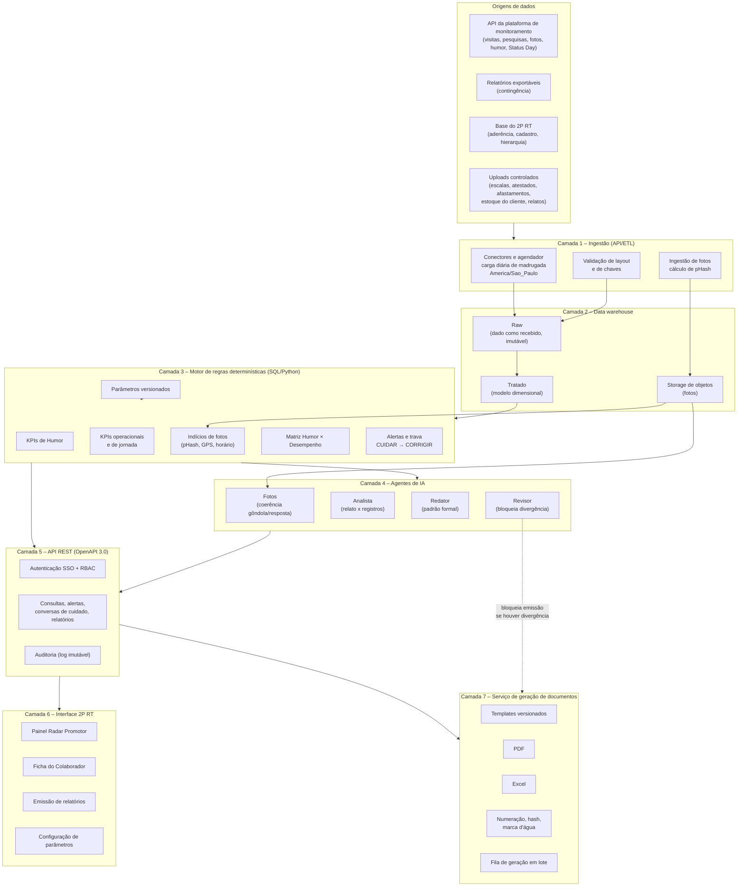
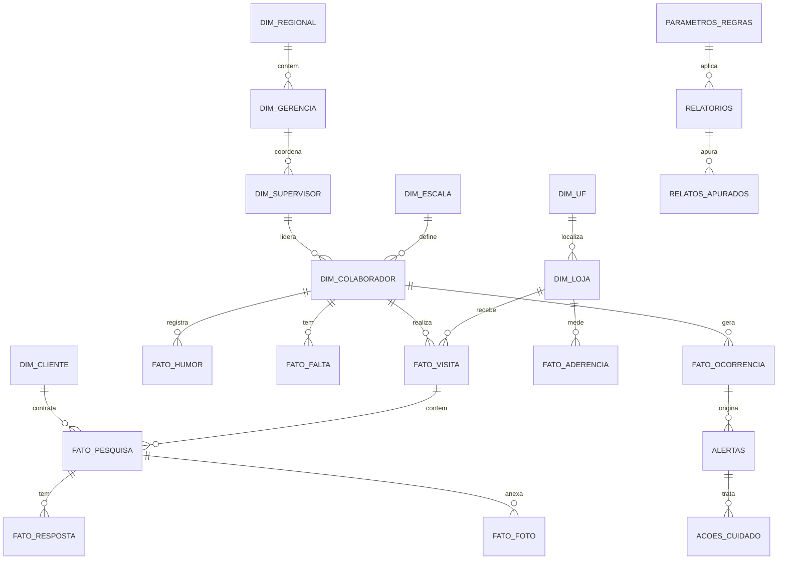

# 1. Arquitetura e especificação técnica

Este documento descreve a arquitetura proposta para o Radar Promotor. A stack real do 2P RT ainda não foi informada (**Q-01**), então a descrição é por camada e por responsabilidade, sem fixar produto ou fornecedor.

## 1.1 Diagrama em blocos

## 1.2 Camadas

### Camada 1 – Ingestão

| Origem | Conteúdo | Modo | Frequência |
|--------|----------|------|-----------|
| API da plataforma de monitoramento | Visitas, check-in/check-out, pesquisas, respostas, fotos, humor, eventos de Status Day | Integração via API (**Q-02**) | Diária, de madrugada |
| Relatórios exportáveis | Os mesmos dados, em arquivo | Contingência e MVP | Diária ou sob demanda |
| Base do 2P RT | Aderência das lojas, cadastro, hierarquia | Leitura direta ou visão (**Q-01**) | Diária |
| Uploads controlados | Escalas, atestados e afastamentos (DP), estoque do cliente/backoffice, relatos da supervisão | Upload com layout validado | Sob demanda |

Regras da ingestão:

- **Fuso:** todo horário é gravado em UTC e apresentado em `America/Sao_Paulo`.
- **Chaves:** `matricula_promotor`, `id_pdv`, `id_pesquisa`, `id_visita`, `data_registro`. Registro sem chave válida vai para uma fila de rejeição e não entra no cálculo.
- **Idempotência:** recarregar o mesmo dia substitui o dia, sem duplicar.
- **Reprocessamento sob demanda:** por data, por colaborador ou por regional, com registro de quem pediu e por quê.
- **Uploads:** cada arquivo recebe ID, autor, data e hash. O upload não altera dado já carregado; gera um novo lote.
- **Monitoramento:** cada carga registra início, fim, volume e situação. Falha ou volume fora do esperado gera alerta para o TI e para o P&P.

### Camada 2 – Data warehouse

- **Raw:** o dado como chegou, sem transformação, com `id_lote`, `fonte` e `data_extracao`. É a base da rastreabilidade.
- **Tratado:** modelo dimensional (seção 1.3), com chaves padronizadas e tipos corrigidos.
- **Storage de objetos:** fotos, com metadados (data e hora de captura, GPS, `id_visita`, `id_pesquisa`) e **pHash calculado na ingestão**.

### Camada 3 – Motor de regras determinísticas

- Todos os KPIs, alertas e a matriz são calculados em SQL/Python, sem IA.
- O mesmo dado e os mesmos parâmetros produzem sempre o mesmo resultado.
- Cada resultado guarda a **versão do parâmetro** usada. Mudar um limite não altera documentos já emitidos.
- A trava CUIDAR → CORRIGIR é aplicada aqui e na API, não só na tela.

### Camada 4 – Agentes de IA

| Agente | Entrada | Saída | Limite |
|--------|---------|-------|--------|
| 1. Fotos | Foto + resposta da pesquisa | Indício de divergência de conteúdo, com score de confiança | Nunca conclui; só sinaliza. Abaixo do score mínimo, o indício não é exibido (**P-14**) |
| 2. Analista | Relato a apurar + resultados do motor de regras | Relato dividido em pontos; cada ponto ligado aos indicadores e classificado | Classifica a partir de números já calculados; não calcula |
| 3. Redator | Pontos classificados + tabelas | Texto no padrão formal | Não cria número; só usa os valores recebidos |
| 4. Revisor | Texto + base | Aprovação ou bloqueio | Bloqueia a emissão se achar termo acusatório, nome de sistema ou número diferente da base |

A classificação de cada ponto do relato (Confirmado / Parcialmente confirmado / Não confirmado / Sem dados suficientes) segue regras objetivas descritas no [dicionário de KPIs](02-dicionario-kpis.md#27-classificação-dos-pontos-do-relato). O Analista propõe; o revisor humano confirma antes da emissão.

### Camada 5 – API REST

- Contrato em OpenAPI 3.0.
- Autenticação por SSO corporativo (**Q-06**) e autorização por perfil (RBAC) em toda rota.
- O filtro por perfil é aplicado no servidor. A tela nunca recebe dado que o perfil não pode ver.
- Toda consulta, edição, emissão e download é gravada na auditoria.

Grupos de rotas previstos:

| Grupo | Finalidade |
|-------|-----------|
| `/indicadores` | KPIs por colaborador, supervisor, loja, regional e UF |
| `/matriz` | Matriz Humor × Desempenho |
| `/alertas` | Lista, detalhe e mudança de etapa dos alertas |
| `/acoes-cuidado` | Registro da Conversa de Cuidado e do plano de ação |
| `/colaboradores/{matricula}` | Ficha do colaborador e linha do tempo |
| `/fotos` | Indícios de fotos e metadados |
| `/relatorios` | Rascunho, revisão, aprovação, emissão, ciência e download |
| `/parametros` | Leitura e alteração de limites, com histórico |
| `/auditoria` | Consulta à trilha de auditoria |

### Camada 6 – Interface 2P RT

Telas descritas em [03-wireframes.md](03-wireframes.md).

### Camada 7 – Serviço de geração de documentos

- PDF e Excel gerados a partir de **templates versionados**. A versão do template fica gravada no documento.
- PDF e Excel do mesmo relatório têm o mesmo número e saem da mesma consulta, para baterem número a número.
- Numeração sequencial por ano: `RP-AAAA-NNNNNN`, com versão (`v1`, `v2`, …).
- Na emissão, o serviço calcula o hash do documento, grava em `relatorios` e imprime o código de verificação no rodapé.
- Em cada download, o PDF recebe marca d'água com nome do usuário e data.
- Gerações em lote entram em fila, sem travar a interface.

## 1.3 Modelagem dimensional

### Dimensões

| Tabela | Grão | Campos principais |
|--------|------|-------------------|
| `dim_colaborador` | Um registro por colaborador e vigência | matricula_promotor, nome, vínculo (CLT/PJ), cargo, data_admissao, data_desligamento, id_supervisor, id_escala, vigência |
| `dim_supervisor` | Um por supervisor e vigência | id_supervisor, nome, id_gerencia |
| `dim_gerencia` | Uma por gerência/coordenação | id_gerencia, nome, id_regional |
| `dim_regional` | Uma por regional | id_regional, nome |
| `dim_uf` | Uma por UF | uf, nome |
| `dim_loja` | Uma por PDV | id_pdv, nome, bandeira, uf, latitude, longitude, tipo (operacional / não operacional) |
| `dim_cliente` | Um por cliente/marca | id_cliente, nome, marca |
| `dim_escala` | Uma por escala e vigência | id_escala, dias, hora_inicio, hora_fim, intervalo |

As dimensões de colaborador, supervisor e escala guardam histórico de vigência. Assim, troca de supervisor, de regional ou de roteiro no meio do período é tratada corretamente.

### Fatos

| Tabela | Grão | Medidas e campos principais |
|--------|------|-----------------------------|
| `fato_visita` | Uma visita a um PDV | id_visita, matricula, id_pdv, data, check-in, check-out, tipo de check-out (manual/automático), GPS de check-in e check-out |
| `fato_pesquisa` | Uma pesquisa programada | id_pesquisa, id_visita, id_cliente, tipo de serviço, situação (programada/respondida/expirada), data programada |
| `fato_resposta` | Uma resposta de pesquisa | id_pesquisa, pergunta, resposta, data e hora |
| `fato_foto` | Uma foto | id_foto, id_pesquisa, id_visita, data e hora de captura, GPS, pHash, caminho no storage |
| `fato_humor` | Um registro de humor por dia e colaborador | matricula, data, opção, pontuação, é_negativo |
| `fato_ocorrencia` | Um indício calculado | id_ocorrencia, tipo, matricula, data, valor, id do registro de origem, versão do parâmetro |
| `fato_aderencia` | Aderência por loja e semana | id_pdv, semana, visitas previstas, visitas realizadas, aderência, meta |
| `fato_falta` | Uma falta, atestado ou afastamento | matricula, data início, data fim, tipo, justificada (S/N), motivo (acesso restrito) |

### Tabelas de apoio

| Tabela | Finalidade |
|--------|-----------|
| `alertas` | Alertas de cuidado e operacionais, com etapa, responsável e datas |
| `acoes_cuidado` | Conversa de Cuidado: data, responsável, plano de ação, reavaliação |
| `relatorios` | Nº, tipo, versão, status, hash, emissor, aprovador, versão do template, versão dos parâmetros |
| `relatos_apurados` | Relato informado, pontos extraídos e conclusão de cada ponto |
| `parametros_regras` | Limites e pesos, com versão, vigência, autor e justificativa |
| `auditoria` | Log imutável de consultas, edições, emissões e downloads |

## 1.4 Requisitos não funcionais

| Requisito | Meta |
|-----------|------|
| Desempenho | Relatório de 1 colaborador/mês gerado em até 60 s |
| Disponibilidade | Horário comercial (janela exata em **Q-12**) |
| Lote | Gerações em lote por fila, com acompanhamento de situação |
| Cargas | Monitoramento diário com alerta de falha |
| Segurança | SSO, RBAC no servidor, dados sensíveis com acesso restrito, tráfego e armazenamento cifrados |
| Auditoria | Log imutável (só inclusão), consultável por Compliance |
| Imutabilidade | Documento emitido nunca é alterado; nova versão numerada |
| Retenção | Conforme política a definir com DPO, DP e Compliance (**Q-09**) |

## 1.5 Garantias dos princípios na arquitetura

| Princípio | Onde é garantido |
|-----------|------------------|
| Humor nunca é punição | RBAC na API; seção de contexto só para perfis autorizados; Revisor bloqueia texto que use humor como fundamento |
| Só indícios | Redator e Revisor aplicam o vocabulário; rodapé fixo em todas as páginas |
| Rastreabilidade | Camada raw + `fato_ocorrencia` com ID de origem + anexo C do PDF + aba Rastreabilidade do Excel |
| Cálculo determinístico | Motor de regras separado dos agentes de IA; agentes não calculam |
| LGPD – "Doente" | Para perfis não autorizados, a API devolve só "alerta de cuidado", sem a opção escolhida |
| Documento imutável | Hash na emissão; alteração cria nova versão em `relatorios` |
