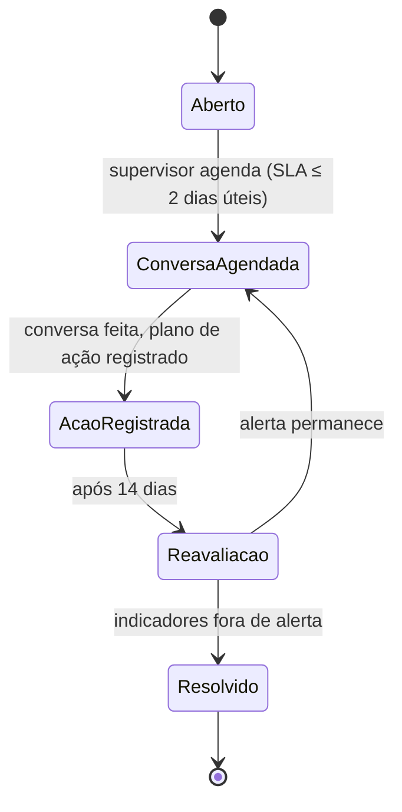

# 2. Dicionário de KPIs e regras de negócio

Todos os indicadores são calculados pelo motor de regras determinísticas (SQL/Python), em carga diária de madrugada (fuso `America/Sao_Paulo`), com reprocessamento sob demanda.

Os limites marcados com **(P-xx)** são premissas e os marcados com **(Q-xx)** dependem de resposta. Ver [07-premissas-e-perguntas.md](07-premissas-e-perguntas.md). Todos os limites são parametrizáveis na tela de configuração, com dono definido (P&P) e histórico de alterações.

## 2.1 Definições de base

| Termo | Definição |
|-------|-----------|
| Dia previsto | Dia em que a escala cadastrada prevê trabalho, excluídos feriados e folgas |
| Dia trabalhado | Dia previsto com pelo menos um check-in, sem falta, atestado ou afastamento (**P-05**) |
| Registro negativo de humor | Cansado, Sobrecarregado, Triste ou Doente (**P-03**) |
| Semana | Segunda a domingo (**P-12**) |
| Dia útil (SLA) | Segunda a sexta, excluídos feriados nacionais (**P-13**) |
| PDV não operacional | Ponto cadastrado para registrar intervalo, deslocamento ou atividade fora de loja |

## 2.2 KPI de Humor (Módulo CUIDAR)

### Valoração

| Opção | Pontos | Negativo? |
|-------|--------|-----------|
| Feliz | 100 | Não |
| Bem | 75 | Não |
| Neutro | 50 | Não |
| Cansado | 25 | Sim |
| Sobrecarregado | 25 | Sim |
| Triste | 0 | Sim |
| Doente | 0 | Sim (dado sensível de saúde) |

As opções e os pontos precisam ser confirmados com as opções reais da pesquisa de abertura de jornada (**Q-03**, **P-02**).

### Indicadores

| KPI | Fórmula | Fonte | Frequência | Meta / limite |
|-----|---------|-------|-----------|---------------|
| Índice de Humor | Média dos pontos dos registros de humor no período. Por colaborador; nos níveis supervisor, loja, regional e UF, média dos índices dos colaboradores com adesão válida | `fato_humor` | Diária | 0 a 100. Alerta abaixo de 50 (**P-04**) |
| Adesão | Dias trabalhados com registro de humor ÷ dias trabalhados | `fato_humor`, `fato_visita` | Diária | ≥ 85% |
| % de dias negativos | Dias com registro negativo ÷ dias com registro | `fato_humor` | Diária | Acompanhamento; sem meta fixa |
| Sequência negativa | Nº de dias trabalhados seguidos com registro negativo | `fato_humor` | Diária | Alerta com ≥ 3 dias seguidos |
| Queda brusca | Média dos últimos 7 dias trabalhados − média dos 60 dias anteriores (**P-19**) | `fato_humor` | Diária | Alerta com queda ≥ 20 pontos |
| Ausência de resposta | Nº de dias trabalhados seguidos sem registro de humor | `fato_humor`, `fato_visita` | Diária | Alerta com ≥ 5 dias |
| SLA do supervisor | Dias úteis entre a abertura do alerta de cuidado e o primeiro registro de ação do supervisor | `alertas`, `acoes_cuidado` | Diária | ≤ 2 dias úteis |
| % de alertas no SLA | Alertas respondidos em até 2 dias úteis ÷ alertas abertos no período | `alertas` | Diária | Meta a definir (**Q-04**) |

### Regras do KPI de Humor

- **Humor em alerta** (para a matriz): Índice de Humor do período abaixo de 50, **ou** sequência negativa ativa, **ou** queda brusca ativa (**P-04**).
- **"Doente":** gera só um alerta de cuidado. Para perfis não autorizados, a opção escolhida não é exibida; aparece apenas "alerta de cuidado".
- **Dias sem trabalho** (folga, feriado, falta, atestado, afastamento) não contam em adesão, sequência nem ausência de resposta.
- **O Humor nunca gera ocorrência de conduta** e nunca entra em ranking individual.

## 2.3 KPIs operacionais (Módulo CORRIGIR)

### Pesquisas

| KPI | Fórmula | Fonte | Frequência | Meta / limite |
|-----|---------|-------|-----------|---------------|
| Pesquisas programadas | Contagem de pesquisas programadas no período, considerando as visitas contratadas | `fato_pesquisa` | Diária | — |
| Pesquisas respondidas | Contagem de pesquisas com situação "respondida" | `fato_pesquisa` | Diária | — |
| Pesquisas expiradas | Contagem de pesquisas com situação "expirada" | `fato_pesquisa` | Diária | — |
| % de pesquisas respondidas | Respondidas ÷ programadas | `fato_pesquisa` | Diária | Meta a definir (**Q-04**) |
| Expiradas em dias trabalhados | Expiradas cuja data programada caiu em dia trabalhado | `fato_pesquisa`, `fato_visita` | Diária | Separa o que é falta do que é não execução |

Aberturas disponíveis: semana, cliente, loja e tipo de serviço.

### Jornada (comparada com a escala cadastrada)

| KPI | Fórmula | Fonte | Frequência | Meta / limite |
|-----|---------|-------|-----------|---------------|
| Atraso | Primeiro check-in do dia − hora de início da escala, quando maior que a tolerância | `fato_visita`, `dim_escala` | Diária | Tolerância de 15 min (**P-06**) |
| Saída antecipada | Hora de fim da escala − último check-out do dia, quando maior que a tolerância | `fato_visita`, `dim_escala` | Diária | Tolerância de 15 min (**P-06**) |
| Check-out automático | Contagem de visitas com check-out feito pelo sistema | `fato_visita` | Diária | Qualquer ocorrência é indício |
| Registros seguidos | Visitas com permanência menor que X minutos no PDV | `fato_visita` | Diária | X = 10 min (**P-07**) |
| Almoço sem registro | Dias trabalhados sem check-in no PDV não operacional entre 12h e 13h | `fato_visita`, `dim_loja` | Diária | Qualquer ocorrência é indício |
| PDOH (horas não registradas) | Horas previstas na escala − horas com registro em PDV (operacional ou não) | `fato_visita`, `dim_escala` | Diária | Definição exata a confirmar (**Q-19**) |
| Tempo ocioso entre PDVs | Intervalo entre o check-out de um PDV e o check-in do seguinte, descontado o almoço, quando maior que o limite | `fato_visita` | Diária | Limite de 60 min (**P-15**) |
| Conformidade de jornada | Dias trabalhados sem nenhum desvio de jornada ÷ dias trabalhados | `fato_ocorrencia` | Diária | Compõe o índice de desempenho |

### Aderência

| KPI | Fórmula | Fonte | Frequência | Meta / limite |
|-----|---------|-------|-----------|---------------|
| Aderência de loja | Visitas realizadas ÷ visitas previstas, por loja e semana | Base do 2P RT, `fato_aderencia` | Diária | Meta de 93%. **Loja com aderência ≥ 93% não entra no Dossiê de Conduta** |
| Aderência de rota | Comparação entre a sequência de PDVs prevista no roteiro e a sequência registrada por GPS, separada em manhã e tarde | `fato_visita`, roteiro | Diária | Forma de cálculo a confirmar (**Q-18**) |

### Faltas e afastamentos

| KPI | Fórmula | Fonte | Frequência | Observação |
|-----|---------|-------|-----------|-----------|
| Faltas | Dias previstos sem check-in e sem justificativa | `fato_falta`, `fato_visita` | Diária | — |
| Faltas justificadas | Dias previstos sem check-in com justificativa registrada | `fato_falta` | Diária | Motivo visível só para DP e RH |
| Atestados | Dias cobertos por atestado | Upload do DP | Sob demanda | O documento do atestado não entra no relatório |
| Afastamentos | Dias cobertos por afastamento | Upload do DP | Sob demanda | Período afastado sai de todos os cálculos |

### Fotos suspeitas (indícios)

| Indício | Regra | Fonte | Quem calcula | Limite |
|---------|-------|-------|--------------|--------|
| Duplicada | Mesmo pHash em visitas ou lojas distintas | `fato_foto` | Motor de regras | Distância de Hamming ≤ 5 (**P-09**) |
| Fora do PDV | Distância entre o GPS da captura e o da loja maior que X metros | `fato_foto`, `dim_loja` | Motor de regras | X = 300 m (**P-08**) |
| Fora do horário | Captura fora do intervalo entre check-in e check-out da visita | `fato_foto`, `fato_visita` | Motor de regras | — |
| Divergência de conteúdo | Foto não condiz com a resposta da pesquisa | `fato_foto`, `fato_resposta` | Agente de IA de fotos | Exibido só com score ≥ 0,80 (**P-14**) |
| Sem GPS | Foto sem coordenada de captura | `fato_foto` | Motor de regras | Não é indício de conduta; aparece como "sem dados de localização" |

Todo indício de foto precisa de conferência humana antes de entrar em um documento.

### Ruptura x estoque

| KPI | Fórmula | Fonte | Frequência | Observação |
|-----|---------|-------|-----------|-----------|
| Ruptura com estoque positivo | Itens informados como ruptura na pesquisa com estoque maior que zero no relatório do cliente, na mesma loja e data | `fato_resposta`, upload de estoque | Sob demanda (depende do upload) | Sem relatório de estoque da data, o item fica "sem dados suficientes" |

## 2.4 Índice de Desempenho

```
Desempenho = (peso_aderencia × Aderência)
           + (peso_pesquisas × % de pesquisas respondidas)
           + (peso_jornada   × Conformidade de jornada)
```

| Componente | Peso (**P-10**) |
|------------|-----------------|
| Aderência | 40% |
| % de pesquisas respondidas | 40% |
| Conformidade de jornada | 20% |

- Os pesos são parametrizáveis e somam 100%.
- **Desempenho alto:** índice ≥ 85. **Desempenho baixo:** índice < 85 (**P-11**, **Q-05**).

## 2.5 Matriz Humor × Desempenho

| Quadrante | Condição | Encaminhamento |
|-----------|----------|----------------|
| **VERMELHO** | Humor em alerta + desempenho baixo | Acompanhamento TD & Merchandising, com **Conversa de Cuidado obrigatória** |
| **AMARELO** | Humor em alerta + desempenho alto | Risco de esgotamento/retenção; revisar rota e carga |
| **AZUL** | Humor ok + desempenho baixo | Orientação e treinamento; elegível a Dossiê de Conduta |
| **VERDE** | Humor ok + desempenho alto | Destaque operacional (campanhas de premiação) |
| **CINZA** | Adesão < 85% | Alerta de adesão |

Regras:

- **CINZA tem precedência.** Com adesão abaixo de 85%, não há base para classificar o humor (**P-21**).
- A matriz é calculada sobre o período selecionado, com no mínimo 10 dias trabalhados (**P-22**).
- O quadrante é contexto de acompanhamento. Não é ocorrência e não fundamenta penalidade.

## 2.6 Ponte CUIDAR → CORRIGIR (trava sistêmica)

**Regra:** para colaborador no quadrante VERMELHO, a emissão do Dossiê de Conduta fica **bloqueada** até o registro formal da Conversa de Cuidado, com data, responsável e plano de ação.

- A trava é aplicada no motor de regras e na API. Não pode ser contornada pela tela nem por perfil.
- O rascunho pode ser preparado, mas não passa de "Em revisão" para "Aprovado" enquanto a trava estiver ativa.
- A tela de emissão mostra o motivo do bloqueio e o atalho para o alerta de cuidado.

### Fluxo do alerta de cuidado



| Etapa | Quem age | Registro obrigatório |
|-------|----------|----------------------|
| Aberto | Sistema | Tipo do alerta, data, indicador que disparou |
| Conversa Agendada | Supervisor | Data da conversa |
| Ação Registrada | Supervisor (RH acompanha) | Data, responsável, plano de ação. **Libera a trava** |
| Reavaliação em 14 dias | Sistema + supervisor | Indicadores recalculados |
| Resolvido | Supervisor ou RH | Conclusão |

## 2.7 Classificação dos pontos do relato

Cada ponto do "Relato a apurar" é ligado a um ou mais indicadores e recebe uma conclusão:

| Conclusão | Critério |
|-----------|----------|
| **CONFIRMADO PELOS REGISTROS** | Os registros do período mostram o fato relatado, com ocorrências acima do limite parametrizado |
| **PARCIALMENTE CONFIRMADO** | Parte do relato tem registro e parte não tem, ou há registro em apenas parte das lojas ou datas citadas |
| **NÃO CONFIRMADO** | Há dados completos do período e eles não mostram o fato relatado |
| **SEM DADOS SUFICIENTES** | Falta a fonte necessária (ex.: sem relatório de estoque do cliente, fotos sem GPS, período sem carga) |

O agente Analista propõe a classificação a partir dos números do motor de regras. O revisor humano confirma ou corrige antes da aprovação. Toda alteração fica na auditoria.

## 2.8 Parâmetros

| Parâmetro | Valor inicial | Origem |
|-----------|---------------|--------|
| Meta de adesão ao humor | 85% | Definido |
| Sequência negativa | 3 dias | Definido |
| Queda brusca | 20 pontos vs. 60 dias | Definido |
| Ausência de resposta | 5 dias trabalhados | Definido |
| SLA do supervisor | 2 dias úteis | Definido |
| Reavaliação do alerta | 14 dias | Definido |
| Corte de aderência para o dossiê | 93% | Definido |
| Limite do Índice de Humor em alerta | 50 | **P-04** |
| Tolerância de atraso e de saída antecipada | 15 min | **P-06** |
| Registros seguidos (permanência mínima) | 10 min | **P-07** |
| Distância máxima da foto ao PDV | 300 m | **P-08** |
| Distância de pHash para duplicidade | ≤ 5 | **P-09** |
| Pesos do desempenho | 40 / 40 / 20 | **P-10** |
| Corte de desempenho alto | 85 | **P-11** |
| Score mínimo da IA de fotos | 0,80 | **P-14** |
| Tempo ocioso entre PDVs | 60 min | **P-15** |

Cada alteração de parâmetro grava: valor anterior, valor novo, autor, data, justificativa e data de início da vigência. Documentos emitidos mantêm a versão dos parâmetros da data da emissão.
