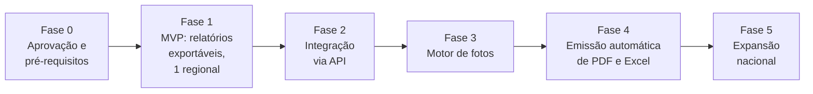

# 6. Plano de fases e plano de testes

## 6.1 Plano de fases

Prazos não foram estimados. Dependem da stack do 2P RT, do acesso à API e do tamanho da equipe de TI (**Q-01**, **Q-02**). Cada fase só começa quando a anterior cumpre o critério de saída.

| Fase | Escopo | Entregas | Critério de saída |
|------|--------|----------|-------------------|
| **0. Aprovação e pré-requisitos** | Validar esta especificação e responder às perguntas bloqueantes | Especificação aprovada pelas áreas · base legal LGPD documentada com o DPO · aviso aos promotores aprovado · opções reais de humor confirmadas · regional piloto escolhida | Todas as perguntas bloqueantes respondidas |
| **1. MVP** | Uma regional. Dados por relatórios exportáveis e uploads | Carga a partir de arquivos · modelo dimensional · KPIs de humor, pesquisas, jornada, aderência e faltas · matriz e trava CUIDAR → CORRIGIR · painel, ficha e alertas · registro da Conversa de Cuidado · RBAC e auditoria · dossiê em rascunho para conferência manual | Regressão contra dossiês manuais sem divergência não explicada · homologação das áreas na regional piloto |
| **2. Integração via API** | Substituir os arquivos pela API da plataforma de monitoramento | Conectores de API · carga diária automática · monitoramento com alerta de falha · reprocessamento sob demanda · arquivos mantidos como contingência | Cargas diárias estáveis · números da API iguais aos dos arquivos no mesmo período |
| **3. Motor de fotos** | Indícios de fotos | Storage de fotos · pHash na ingestão · regras de duplicidade, distância e horário · agente de IA de fotos com score · galeria com conferência humana | Taxa de falso positivo aceita pelo P&P em amostra conferida |
| **4. Emissão automática** | Documentos formais | Templates versionados de PDF e Excel · agentes Analista, Redator e Revisor · fluxo Rascunho → Arquivado · numeração, hash e marca d'água · fila de lote · os quatro tipos de relatório | PDF e Excel batem número a número · relatório de 1 colaborador/mês em até 60 s · homologação de Compliance e RH |
| **5. Expansão nacional** | Demais regionais, por ondas | Entrada regional a regional · treinamento por perfil · ajuste de parâmetros · política de retenção em operação | Todas as regionais em uso, com adesão ao humor medida |

Observações:

- **SSO, RBAC e auditoria entram já na Fase 1.** O piloto usa dados reais de pessoas.
- **Na Fase 1 o dossiê não tem valor formal.** O documento sai marcado como rascunho e a equipe confere contra o processo manual.
- **O processo manual continua em paralelo** até o fim da Fase 4 na regional piloto.

## 6.2 Plano de testes e validação

### Piloto

- 2 a 3 promotores por regional, em período fechado (mês encerrado).
- Começa por uma regional e expande por ondas.
- Os promotores do piloto devem cobrir, juntos, vínculos CLT e PJ, mais de uma escala e mais de um cliente.

### Testes da matriz

Um caso de teste para cada quadrante, com dados montados para cair exatamente nele:

| Caso | Condição montada | Resultado esperado |
|------|------------------|--------------------|
| VERMELHO | Humor em alerta + desempenho abaixo do corte | Alerta de cuidado aberto · emissão do Dossiê de Conduta bloqueada · liberada após o registro da Conversa de Cuidado |
| AMARELO | Humor em alerta + desempenho alto | Alerta de risco de esgotamento · sem trava |
| AZUL | Humor ok + desempenho baixo | Elegível a Dossiê de Conduta · sem trava |
| VERDE | Humor ok + desempenho alto | Destaque operacional |
| CINZA | Adesão abaixo de 85% | Alerta de adesão · sem classificação de humor |

Testes de fronteira: índice exatamente no corte, adesão exatamente em 85%, sequência negativa de 2 e de 3 dias, queda de 19 e de 20 pontos.

Testes da trava: tentar emitir pela tela e direto pela API; tentar com cada perfil; registrar a conversa sem plano de ação (deve continuar bloqueado).

### Casos de borda

| Caso | O que se verifica |
|------|-------------------|
| Feriados (nacional, estadual, municipal) | Dia não conta como previsto, nem em adesão, nem como falta |
| Folgas | Idem |
| Atestados | Dias cobertos saem de todos os cálculos; motivo não aparece para perfis não autorizados |
| Troca de roteiro no período | Aderência calculada com o roteiro vigente em cada data |
| PDV não operacional | Não conta como visita de loja; conta para o registro de intervalo |
| PJ | Regras de jornada aplicadas conforme a definição das áreas (**Q-11**) |
| Virada de mês | Semana dividida entre dois meses; período que cruza o mês |
| Fotos sem GPS | Não geram indício de distância; aparecem como "sem dados de localização" |
| Colaborador em múltiplas regionais | Cada gerência vê só os registros da própria regional; o dossiê consolida para perfis nacionais |
| Colaborador desligado no período | Cálculo só até a data de desligamento; documento ainda pode ser emitido |
| Troca de supervisor no período | Alertas e SLA atribuídos ao supervisor vigente em cada data |
| Dia com check-in e sem check-out | Tratado como check-out automático ou ausente, sem quebrar o cálculo |
| Carga do dia falhou | Indicadores do dia marcados como "sem dados"; documento não é emitido com período incompleto |
| Upload de estoque ausente | Ponto de ruptura classificado como "sem dados suficientes" |
| Horário de verão / fuso | Horários corretos em `America/Sao_Paulo` para lojas em outros fusos (**Q-17**) |

### Regressão contra dossiês manuais históricos

- Selecionar dossiês manuais já concluídos e gerar os mesmos casos no sistema.
- Comparar número a número.
- **Toda divergência é explicada e registrada.** Se o erro for do motor de regras, corrige-se o motor. Se for do dossiê manual, registra-se a evidência.
- Os casos viram testes automatizados permanentes.

### Testes de documento

| Teste | Critério |
|-------|----------|
| PDF x Excel | Todos os números do PDF batem com as abas do Excel |
| Paginação | "Página X de Y" correta; rodapé em todas as páginas |
| Quebra de tabela | Cabeçalho repetido; nenhuma linha cortada |
| Anexo com 100+ fotos | Geração conclui, legendas completas, tamanho do arquivo aceitável |
| Código de verificação | O hash impresso confere com o gravado em `relatorios` |
| Imutabilidade | Alterar documento emitido gera a versão seguinte; a anterior permanece intacta |
| Marca d'água | Nome do usuário e data em todo PDF baixado |
| Redação | Sem saudações, sem termos acusatórios, sem nomes de sistemas no corpo, parágrafo final iniciado por "Sendo assim," |
| Limite de blocos | No máximo 5 blocos de achados e 1 gráfico por bloco |
| Dossiê de Conduta | Não traz metas atingidas nem lojas com aderência ≥ 93% |
| Revisor | Número alterado de propósito no texto bloqueia a emissão |
| Desempenho | 1 colaborador/mês em até 60 s; lote não trava a interface |

### Testes de permissão

- Para cada um dos 8 perfis, percorrer todas as telas e todas as rotas da API e conferir com a [matriz de permissões](05-matriz-permissoes.md).
- Tentar acessar dado fora do escopo (outra regional, outra equipe) direto pela API.
- Baixar PDF e Excel com cada perfil e conferir: seção de contexto, aba Humor, motivo de falta, marca d'água.
- Conferir que "Doente" nunca aparece para perfis não autorizados, em tela, exportação ou log.
- Conferir que todo acesso gerou registro na auditoria.

### Homologação

Um representante de cada área valida os casos da própria área e assina o aceite:

| Área | Foco da homologação |
|------|---------------------|
| Diretoria | Visão executiva, matriz, rankings |
| RH | Humor, alertas, conversas de cuidado, Relatório de Acompanhamento |
| DP | Jornada, faltas, atestados, Relatório de Jornada |
| Compliance | Dossiês emitidos, versões, trilha de auditoria, redação |
| P&P | KPIs, parâmetros, geração e revisão de dossiês, regressão |
| Merchandising / TD | Pesquisas, fotos, planos de ação |
| Supervisão | Painel da equipe, alertas, registro da Conversa de Cuidado |
| TI | Cargas, monitoramento, desempenho, segurança |
